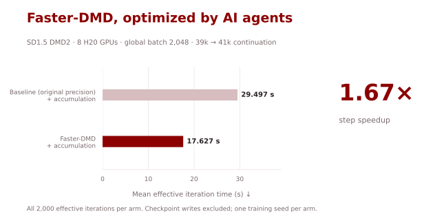
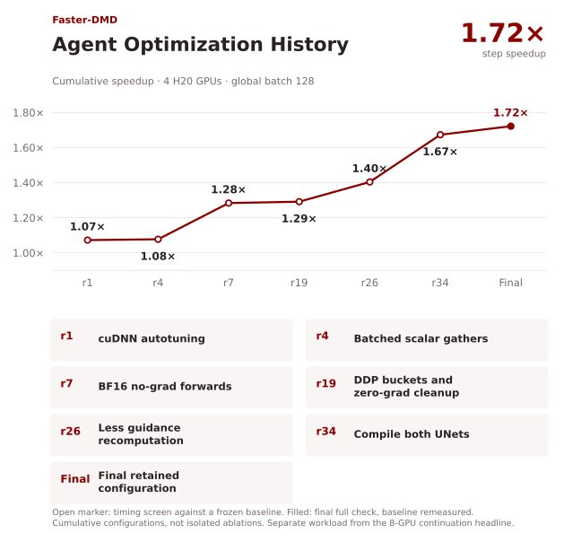
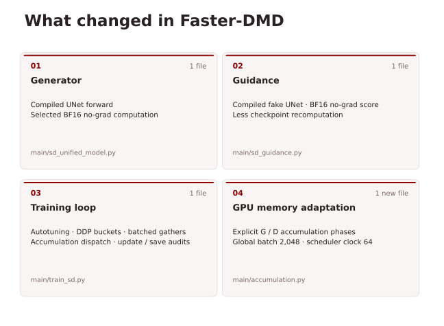

# Faster-DMD

[English](README.md) | [简体中文](README.zh-CN.md)

**1.67× faster SD1.5 DMD2 training steps on 8 H20 GPUs, optimized by AI agents.**



| Implementation | FID-30k ↓ | Mean iteration time (s) ↓ | Speedup ↑ |
|---|---:|---:|---:|
| Baseline | 8.6536 | 29.497 | 1.00× |
| **Faster-DMD** | **8.7030** | **17.627** | **1.67×** |

Both runs start from the official 39k checkpoint and continue for **2,000 effective iterations** on **8 H20 GPUs**, with a global batch of **2,048**. The baseline retains the upstream model computations and precision settings.

Timing averages all 2,000 iterations and excludes checkpoint writes. The optimized run is **1.67× faster**, with FID-30k **8.7030 versus 8.6536** for the baseline (lower is better). Each configuration was trained once, using seed 10.

## Quick Start

On Linux with CUDA, prepare the [environment, public data and model weights](docs/training.md), then continue from the official 39k checkpoint on **8 GPUs**:

```bash
export DMD_ASSETS=/path/to/assets
export DMD_REAL_LMDB=/path/to/sd_vae_latents_laion_500k_lmdb
export DMD_OUTPUT=/path/to/new-output
bash scripts/train_faster_sd15.sh
```

For another GPU count or memory budget, adjust `NPROC`, `MICROBATCH` and `GRAD_ACCUM` while preserving global batch **2,048**. See [GPU adaptation](docs/training.md#memory-and-reproduction) and the [accumulation semantics and checks](docs/gradient-accumulation.md). The measured default uses 96 GB H20 GPUs; an 80 GB configuration needs its own memory probe.

## Agent Optimization History

The earlier optimization sequence used **4 H20 GPUs, microbatch 32, accumulation 1, global batch 128**. The final benchmark measured **3.7368 s/iteration for the reference and 2.1704 s/iteration for the optimized configuration**, a **1.72×** speedup. Its smaller global batch and short measurement window differ from the eight-GPU continuation above, so the iteration times are not directly comparable.



Points are cumulative configurations, not isolated ablations. The final configuration passed the short-trajectory statistical check. See [validation details](docs/performance-views/README.md).

## What changed

- **UNets:** compile the generator and fake-guidance UNets; use BF16 in selected no-gradient forwards and reduce guidance recomputation.
- **Training overhead:** cuDNN autotuning, DDP bucket views, batched scalar gathers and redundant zero-gradient removal.
- **Eight-GPU training:** gradient accumulation keeps the upstream global batch of 2,048, one generator update per ten guidance updates, and the upstream learning-rate schedule. Both comparison runs use this implementation; accumulation is not an additional difference behind the reported speedup.



See the [file-by-file review](docs/change-views/review-table.md), [portable launcher](scripts/train_faster_sd15.sh) and [archived measured command](training/h20/run_optimized.sh). The original-precision baseline already contains upstream BF16/FP16/TF32 paths; it is not all-FP32 training.

## Continuation results

We completed two **39k→41k continuations** on **8 H20 GPUs**: the baseline and Faster-DMD. Here, continuation means starting from the official checkpoint at iteration 39,000 and training for another 2,000 effective iterations, ending at 41,000. Following the upstream recipe, both runs load the checkpoint weights and restart Adam and learning-rate warmup, rather than restoring the optimizer state. Each run completes **2,000 guidance updates and 200 generator updates**.

| Implementation | FID-30k ↓ |
|---|---:|
| Baseline | 8.6536 |
| **Faster-DMD** | **8.7030** |

Faster-DMD has a slightly higher FID than the baseline (+0.0494). Both are evaluated using **30,000 COCO prompts, seed 10, evaluation batch 10, a one-step epsilon→x0 sampler and the bundled cleanFID pipeline**, with 256-pixel evaluation and 40,504 COCO validation reference images.

Summed logged iteration time is **16.39 h → 9.79 h**, a **1.67×** speedup; checkpoint writes and other time outside those entries are excluded. See the [H20 results, training settings and evaluation protocol](docs/h20-results.md) and [Results (JSON)](evaluation/20261017/completed_comparison_summary.json).

Both runs use gradient accumulation to maintain the upstream global batch of **2,048** on eight GPUs: **8 GPUs × 32 samples per microbatch × 8 accumulation steps**. Each effective iteration includes one guidance update after accumulating the microbatches; the generator updates every ten iterations. The same accumulation implementation is used in both runs.

> **Reference checkpoints:** Under the same evaluation protocol, the official **39k** starting checkpoint scores **9.2758 FID**, and the official released **41k** checkpoint scores **8.3429 FID**. Both continuations improve on the starting checkpoint but remain above the official 41k result. These checkpoints provide quality references; their training times are not part of the speedup comparison.

## Upstream DMD2 documentation

Based on [tianweiy/DMD2](https://github.com/tianweiy/DMD2), by Tianwei Yin, Michaël Gharbi, Taesung Park, Richard Zhang, Eli Shechtman, Frédo Durand and William T. Freeman. [Paper](https://arxiv.org/abs/2405.14867) · [Project page](https://tianweiy.github.io/dmd2/) · [CC-BY-NC-SA 4.0 license](LICENSE.md). The original README and authorship are retained below.

<details>
<summary>Original DMD2 README: environment, data, training and evaluation</summary>

## Improved Distribution Matching Distillation for Fast Image Synthesis [[Huggingface Repo](https://huggingface.co/tianweiy/DMD2)][[ComfyUI](https://gist.github.com/comfyanonymous/fcce4ced378f74f4c46026b134faf27a)][[Colab](https://colab.research.google.com/drive/1iGk7IW2WosophOVYpdW_KZGIfYpATOm7?usp=sharing)]

Few-step Text-to-Image Generation.


> [**Improved Distribution Matching Distillation for Fast Image Synthesis**](https://tianweiy.github.io/dmd2/),
> Tianwei Yin, Michaël Gharbi, Taesung Park, Richard Zhang, Eli Shechtman, Frédo Durand, William T. Freeman
> *NeurIPS 2024 ([arXiv 2405.14867](https://arxiv.org/abs/2405.14867))*

## Contact

Feel free to contact us if you have any questions about the paper!

Tianwei Yin [tianweiy@mit.edu](mailto:tianweiy@mit.edu)

## Abstract

Recent approaches have shown promises distilling diffusion models into
efficient one-step generators. Among them, Distribution Matching Distillation
(DMD) produces one-step generators that match their teacher in distribution,
without enforcing a one-to-one correspondence with the sampling trajectories of
their teachers. However, to ensure stable training, DMD requires an additional
regression loss computed using a large set of noise-image pairs generated by
the teacher with many steps of a deterministic sampler. This is costly for
large-scale text-to-image synthesis and limits the student's quality, tying it
too closely to the teacher's original sampling paths. We introduce DMD2, a set
of techniques that lift this limitation and improve DMD training. First, we
eliminate the regression loss and the need for expensive dataset construction.
We show that the resulting instability is due to the fake critic not estimating
the distribution of generated samples accurately and propose a two time-scale
update rule as a remedy. Second, we integrate a GAN loss into the distillation
procedure, discriminating between generated samples and real images. This lets
us train the student model on real data, mitigating the imperfect real score
estimation from the teacher model, and enhancing quality. Lastly, we modify the
training procedure to enable multi-step sampling. We identify and address the
training-inference input mismatch problem in this setting, by simulating
inference-time generator samples during training time. Taken together, our
improvements set new benchmarks in one-step image generation, with FID scores
of 1.28 on ImageNet-64x64 and 8.35 on zero-shot COCO 2014, surpassing the
original teacher despite a 500X reduction in inference cost. Further, we show
our approach can generate megapixel images by distilling SDXL, demonstrating
exceptional visual quality among few-step methods.

## Environment Setup

```.bash
# In conda env
conda create -n dmd2 python=3.8 -y
conda activate dmd2

pip install --upgrade anyio
pip install -r requirements.txt
python setup.py  develop
```

## Inference Example

#### ImageNet

```.bash
python -m demo.imagenet_example  --checkpoint_path IMAGENET_CKPT_PATH
```

#### Text-to-Image

```.bash
# Note: on the demo page, click ``Use Tiny VAE for faster decoding'' to enable much faster speed and lower memory consumption using a Tiny VAE from [madebyollin](https://huggingface.co/madebyollin/taesdxl)

# 4 step (much higher quality than 1 step)
python -m demo.text_to_image_sdxl --checkpoint_path SDXL_CKPT_PATH --precision float16

# 1 step
python -m demo.text_to_image_sdxl --num_step 1 --checkpoint_path SDXL_CKPT_PATH --precision float16 --conditioning_timestep 399
```

We can also use the standard diffuser pipeline:

#### 4-step UNet generation

```python
import torch
from diffusers import DiffusionPipeline, UNet2DConditionModel, LCMScheduler
from huggingface_hub import hf_hub_download
from safetensors.torch import load_file
base_model_id = "stabilityai/stable-diffusion-xl-base-1.0"
repo_name = "tianweiy/DMD2"
ckpt_name = "dmd2_sdxl_4step_unet_fp16.bin"

# Load model.
with torch.device("meta"):
    unet = UNet2DConditionModel.from_config(base_model_id, subfolder="unet").to(torch.float16)
state_dict_path = hf_hub_download(repo_name, ckpt_name)
unet.load_state_dict(torch.load(state_dict_path), assign=True)
unet.to("cuda")

pipe = DiffusionPipeline.from_pretrained(base_model_id, unet=unet, torch_dtype=torch.float16, variant="fp16").to("cuda")
pipe.scheduler = LCMScheduler.from_config(pipe.scheduler.config)
prompt="a photo of a cat"

# LCMScheduler's default timesteps are different from the one we used for training
image=pipe(prompt=prompt, num_inference_steps=4, guidance_scale=0, timesteps=[999, 749, 499, 249]).images[0]
```

#### 4-step LoRA generation

```python
import torch
from diffusers import DiffusionPipeline, UNet2DConditionModel, LCMScheduler
from huggingface_hub import hf_hub_download
from safetensors.torch import load_file
base_model_id = "stabilityai/stable-diffusion-xl-base-1.0"
repo_name = "tianweiy/DMD2"
ckpt_name = "dmd2_sdxl_4step_lora_fp16.safetensors"
# Load model.
pipe = DiffusionPipeline.from_pretrained(base_model_id, torch_dtype=torch.float16, variant="fp16").to("cuda")
pipe.load_lora_weights(hf_hub_download(repo_name, ckpt_name))
pipe.fuse_lora(lora_scale=1.0)  # we might want to make the scale smaller for community models

pipe.scheduler = LCMScheduler.from_config(pipe.scheduler.config)
prompt="a photo of a cat"

# LCMScheduler's default timesteps are different from the one we used for training
image=pipe(prompt=prompt, num_inference_steps=4, guidance_scale=0, timesteps=[999, 749, 499, 249]).images[0]
```

#### 1-step UNet generation

```python
import torch
from diffusers import DiffusionPipeline, UNet2DConditionModel, LCMScheduler
from huggingface_hub import hf_hub_download
from safetensors.torch import load_file
base_model_id = "stabilityai/stable-diffusion-xl-base-1.0"
repo_name = "tianweiy/DMD2"
ckpt_name = "dmd2_sdxl_1step_unet_fp16.bin"
# Load model.
unet = UNet2DConditionModel.from_config(base_model_id, subfolder="unet").to("cuda", torch.float16)
unet.load_state_dict(torch.load(hf_hub_download(repo_name, ckpt_name), map_location="cuda"))
pipe = DiffusionPipeline.from_pretrained(base_model_id, unet=unet, torch_dtype=torch.float16, variant="fp16").to("cuda")
pipe.scheduler = LCMScheduler.from_config(pipe.scheduler.config)
prompt="a photo of a cat"
image=pipe(prompt=prompt, num_inference_steps=1, guidance_scale=0, timesteps=[399]).images[0]
```

#### 4-step T2I Adapter

```python
from diffusers import StableDiffusionXLAdapterPipeline, T2IAdapter, AutoencoderKL, UNet2DConditionModel, LCMScheduler
from diffusers.utils import load_image, make_image_grid
from controlnet_aux.canny import CannyDetector
from huggingface_hub import hf_hub_download
import torch

# load adapter
adapter = T2IAdapter.from_pretrained("TencentARC/t2i-adapter-canny-sdxl-1.0", torch_dtype=torch.float16, varient="fp16").to("cuda")

vae=AutoencoderKL.from_pretrained("madebyollin/sdxl-vae-fp16-fix", torch_dtype=torch.float16)

base_model_id = "stabilityai/stable-diffusion-xl-base-1.0"
repo_name = "tianweiy/DMD2"
ckpt_name = "dmd2_sdxl_4step_unet_fp16.bin"
# Load model.
unet = UNet2DConditionModel.from_config(base_model_id, subfolder="unet").to("cuda", torch.float16)
unet.load_state_dict(torch.load(hf_hub_download(repo_name, ckpt_name), map_location="cuda"))

pipe = StableDiffusionXLAdapterPipeline.from_pretrained(
    base_model_id, unet=unet, vae=vae, adapter=adapter, torch_dtype=torch.float16, variant="fp16",
).to("cuda")
pipe.scheduler = LCMScheduler.from_config(pipe.scheduler.config)
pipe.enable_xformers_memory_efficient_attention()

canny_detector = CannyDetector()

url = "https://huggingface.co/Adapter/t2iadapter/resolve/main/figs_SDXLV1.0/org_canny.jpg"
image = load_image(url)

# Detect the canny map in low resolution to avoid high-frequency details
image = canny_detector(image, detect_resolution=384, image_resolution=1024)#.resize((1024, 1024))

prompt = "Mystical fairy in real, magic, 4k picture, high quality"

gen_images = pipe(
  prompt=prompt,
  image=image,
  num_inference_steps=4,
  guidance_scale=0,
  adapter_conditioning_scale=0.8,
  adapter_conditioning_factor=0.5,
  timesteps=[999, 749, 499, 249]
).images[0]
gen_images.save('out_canny.png')
```

Pretrained models can be found in [ImageNet](experiments/imagenet/README.md) and [SDXL](experiments/sdxl/README.md).

## Training and Evaluation

### ImageNet-64x64

Please refer to [ImageNet-64x64](experiments/imagenet/README.md) for details.

### SDXL

Please refer to [SDXL](experiments/sdxl/README.md) for details.

### SDv1.5

Please refer to [SDv1.5](experiments/sdv1.5/README.md) for details.

## License

Improved Distribution Matching Distillation is released under [Creative Commons Attribution-NonCommercial-ShareAlike 4.0 International License](LICENSE.md).

## Known Issues

- [ ] Current FSDP for SDXL training is really slow; help is greatly appreciated!
- [ ] Current LORA training is actually slower than the full finetuning and takes the same amount of memory; help is greatly appreciated!


## Citation

If you find DMD2 useful or relevant to your research, please kindly cite our papers:

```bib
@inproceedings{yin2024improved,
    title={Improved Distribution Matching Distillation for Fast Image Synthesis},
    author={Yin, Tianwei and Gharbi, Micha{\"e}l and Park, Taesung and Zhang, Richard and Shechtman, Eli and Durand, Fredo and Freeman, William T},
    booktitle={NeurIPS},
    year={2024}
}

@inproceedings{yin2024onestep,
    title={One-step Diffusion with Distribution Matching Distillation},
    author={Yin, Tianwei and Gharbi, Micha{\"e}l and Zhang, Richard and Shechtman, Eli and Durand, Fr{\'e}do and Freeman, William T and Park, Taesung},
    booktitle={CVPR},
    year={2024}
}
```

## Third-part Code

[EDM](https://github.com/NVlabs/edm/tree/main) for [dnnlib](dnnlib), [torch_utils](torch_utils) and [edm](third_party/edm) folders.

## Acknowledgments

This work was done while Tianwei Yin was a full-time student at MIT. It was developed based on our reimplementation of the original DMD paper. This work was supported by the National Science Foundation under Cooperative Agreement PHY-2019786 (The NSF AI Institute for Artificial Intelligence and Fundamental Interactions, http://iaifi.org/), by NSF Grant 2105819, by NSF CISE award 1955864, and by funding from Google, GIST, Amazon, and Quanta Computer.


</details>
